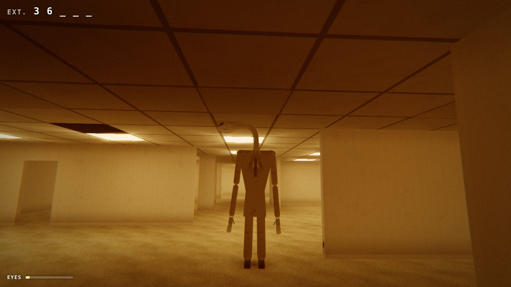

# Please Hold (Backrooms Level 0)

A first-person horror game in the endless yellow rooms of Backrooms Level 0.

Five phones ring, one at a time. Each call gives you one digit of an
extension. Dial it on the red phone to be transferred out. Every time you
hang up the power cuts out, and when it comes back more of the lights are
dead for good.

After the first call you are not alone. The Tenant is a figure in a stained
beige suit, too tall for the ceiling, with its neck bent sideways along the
tiles and a face that is just the wallpaper. It only moves while your eyes
are closed. With the camera on, the webcam watches your real eyes, so every
time you actually blink, it is closer. Without a camera, your eyes dry out
and blink on their own. Hold <kbd>Space</kbd> to keep them open while the
picture stings, blurs and waters.



There is also a "just walk" mode: Level 0 with nothing in it.

## Run it

Static files, no build step. Three.js and MediaPipe load from jsDelivr.
Camera access needs `https://` or `localhost`:

```sh
cd sites/backrooms
python3 -m http.server 8000
# open http://localhost:8000
```

On GitHub Pages it is published at
<https://ashokaitoolss-cell.github.io/t-m/backrooms/> (see
`.github/workflows/pages.yml`).

## Controls

| | |
| --- | --- |
| <kbd>W</kbd> <kbd>A</kbd> <kbd>S</kbd> <kbd>D</kbd> / <kbd>↑</kbd> <kbd>↓</kbd> | walk |
| <kbd>Shift</kbd> | run |
| mouse | look (click the view to capture the mouse) |
| <kbd>←</kbd> <kbd>→</kbd> | turn |
| <kbd>E</kbd> | answer a phone |
| <kbd>Space</kbd> (hold) | keep your eyes open (no camera) |
| <kbd>B</kbd> | blink, when you choose to (no camera) |
| <kbd>0</kbd>–<kbd>9</kbd>, <kbd>Backspace</kbd> | dial, on the red phone |
| <kbd>C</kbd> | recenter your head (camera mode) |
| <kbd>M</kbd> / <kbd>V</kbd> / <kbd>F</kbd> | sound / REC overlay / fullscreen |
| <kbd>Esc</kbd> | menu: sensitivity, volume, gentler jumpscares, reduced flashing, sound captions, the Operator's voice, hiding the digits |
| touch | drag on the left half to walk, on the right half to look; tap to answer; hold the eye button to keep your eyes open |

## How it plays

- **Phones.** One rings at a time, a few rooms away. With headphones you
  can find it by ear: the bell is positioned in 3D and muffled when it's
  round corners. Sound captions (on by default) also point the way.
- **Calls.** Pick up and you're on hold (*Für Elise*, on a cheap synth, on
  worn tape). Then the Operator gives you a digit, by speech synthesis where
  the browser has a voice, with subtitles either way. You can't walk while
  you're on the phone. The Operator's voice and the music wear down with
  every call.
- **Lights.** Hanging up cuts the power. The lights stutter back, but more
  panels are dead each time (7% at the start, about half by the end) and more
  of them flicker.
- **The Tenant.** It appears when the lights come back after the first call.
  Each time your eyes close it steps closer along the rooms, a little more
  with every digit you have. A long blink or a lost face (camera mode)
  lets it keep walking. It moves in blackouts too, but never all the way.
  When you open your eyes it is standing differently. From the third call
  on, you can hear it humming the hold music.
- **Caught.** If it reaches you, you're back at the last phone you answered
  with the digits you already have.
- **The red phone.** After five digits it rings somewhere further away.
  Dial the extension. A wrong number costs you a blackout.

**Blinks on the webcam.** MediaPipe's `eyeBlinkLeft`/`eyeBlinkRight`
blendshapes, averaged. The tracker follows your open-eye level (lower
envelope) and your blink peaks (upper envelope), so it adapts to your face,
glasses and light, and switches with hysteresis between them. Looking down
is discounted. If it can't find your face for half a second, your eyes count
as closed.

**Looking with your head:** turn your head and the view turns further
(2.2× by default). Hold it turned past about 14° and you keep turning that
way, so you can go all the way round without leaving the screen. Lean to
peek round corners. If the camera loses you, the view eases back to straight
ahead. The mouse and keyboard still work alongside it.

## How it feels

Movement and camera follow the reference Level 0 footage the walk was built from:

- You start lying on the carpet and get up.
- The view eases after the mouse instead of snapping to it. It banks into
  turns and drifts a little like a hand-held camera.
- Walking adds a bob and sway, at 1.55 m/s (3.3 m/s running), with a little
  inertia.
- Fast turns smear with motion blur.
- Wide 92° lens, an over-bright warm grade, bloom on the lights.

## How it works

| File | |
| --- | --- |
| `js/world.js` | The floor plan, a pure function of the seed. Walls run in broken lines along a 3.6 m grid (long walls with gaps, doorways, tight mazes in some regions, open pillared halls in others). Also collision boxes and a spawn search that never starts you in a sealed pocket |
| `js/chunks.js` | Streams 8×8-cell chunks within ~100 m: merged wall geometry, floor and ceiling with a baked occlusion map, light panels |
| `js/shaders.js` | Wallpaper, carpet, ceiling and panel shaders, plus the camcorder pass |
| `js/player.js` | Movement, collisions, and the camera behaviour above |
| `js/input.js` | Keyboard, pointer-lock mouse, touch sticks |
| `js/head-tracker.js` | MediaPipe Face Landmarker: head position, plus yaw and pitch from its pose matrix |
| `js/audio.js` | Synthesised hum, ballast buzz, room tone, footsteps, and the limiter |
| `js/game.js` | The game: phones, calls, blackouts, the Tenant's movement, the jumpscare, the dial |
| `js/tenant.js` | The Tenant, built from primitives: suit, long arms, the neck bent along the tiles, a face shaped under the wallpaper; random stances; walking a route |
| `js/phones.js` | Desk phones on side tables: ringing, answered, off the hook |
| `js/eyes.js` | Your eyes: webcam blinks, or drying out, fighting it with <kbd>Space</kbd>, and blinking |
| `js/sfx.js` | Game sound, all synthesised: bells, hold music, DTMF, the Tenant's creaks, breathing and humming, drone, heartbeat, stingers, the scream |
| `js/voice.js` | The Operator: speech synthesis with a babble fallback |
| `js/hud.js` | Extension, subtitles, captions, prompts, eye meter, dial pad, end cards |
| `js/main.js` | Wiring, menus, head look mapping |

**Routes.** Rooms sit on a 3.6 m grid, so finding your way is a
breadth-first search over cells, through doorways and open edges. The game
keeps a distance field from your cell (rebuilt when you cross into another).
The Tenant follows it downhill, and it also aims the ring captions and the
muffling of the bell.

**Lighting.** Every cell has a panel in the middle of its ceiling. Each
fragment adds up light from the nine nearest panels as downward-facing area
lights. There are no light objects at all, so the light is the same however
far you walk. Whether a panel is on, dead or flickering comes from an integer
hash that is bit-identical in JavaScript and GLSL. The panels you see, the
light they throw and the buzz you hear therefore always agree. The game
turns three uniforms: the fraction of panels that are dead (it only grows,
so a dead light stays dead), how many flicker, and the mains power (zero in
a blackout). Ambient light follows how many panels around you are lit.

**The look.** Surfaces are nearly neutral and the yellow comes from the
grade. It is a per-channel curve, roughly (r^0.45, g^0.8, b^1.8) after a soft
tone map. I fitted it to colours measured in the reference footage: walls
come out ochre, the ceiling a deep orange-brown, and the panels stay white.

## Assets and credits

- Carpet (Carpet011), ceiling tiles (OfficeCeiling001) and wall stains
  (Wallpaper002B) are from [ambientCG](https://ambientcg.com), CC0. The
  wallpaper pattern, baseboards and outlets are drawn in the shader.
- Hold music: Ludwig van Beethoven, *Für Elise* (1810), played by a synth
  in the browser.
- [three.js](https://threejs.org) r186 for rendering;
  [MediaPipe Face Landmarker](https://ai.google.dev/edge/mediapipe/solutions/vision/face_landmarker)
  for head tracking and blinks.
- The Backrooms began as a 2019 creepypasta. This is a fan-made interpretation
  of its Level 0.
